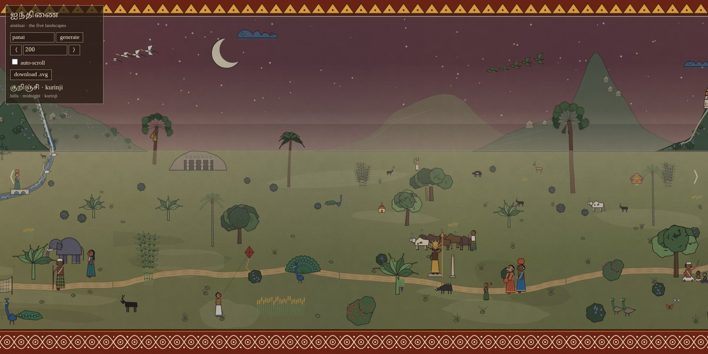
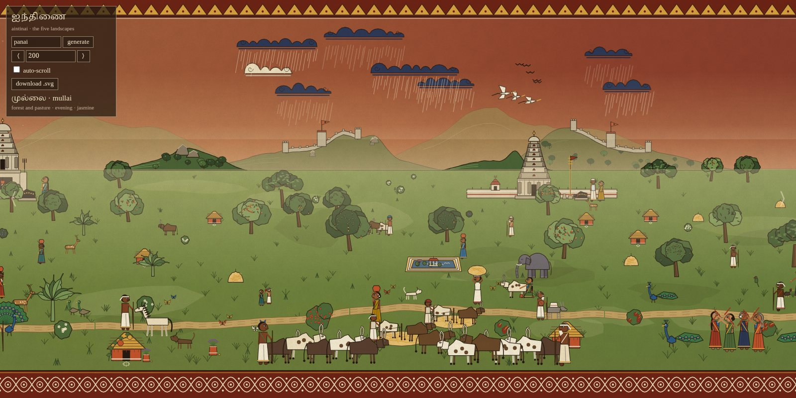
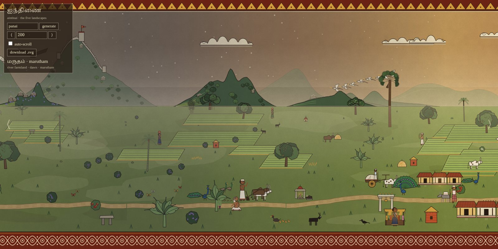
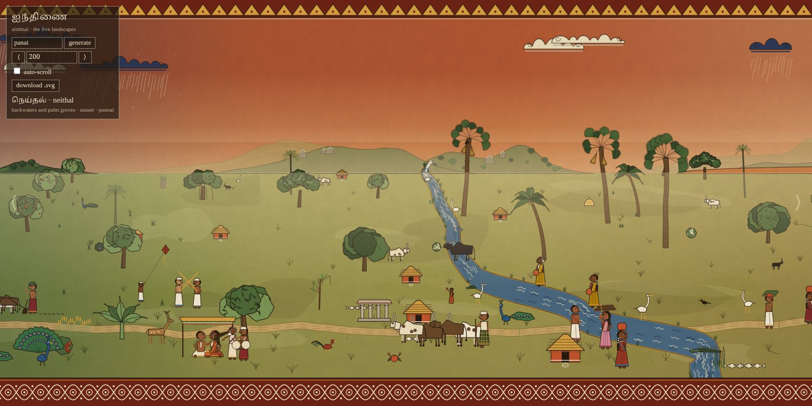
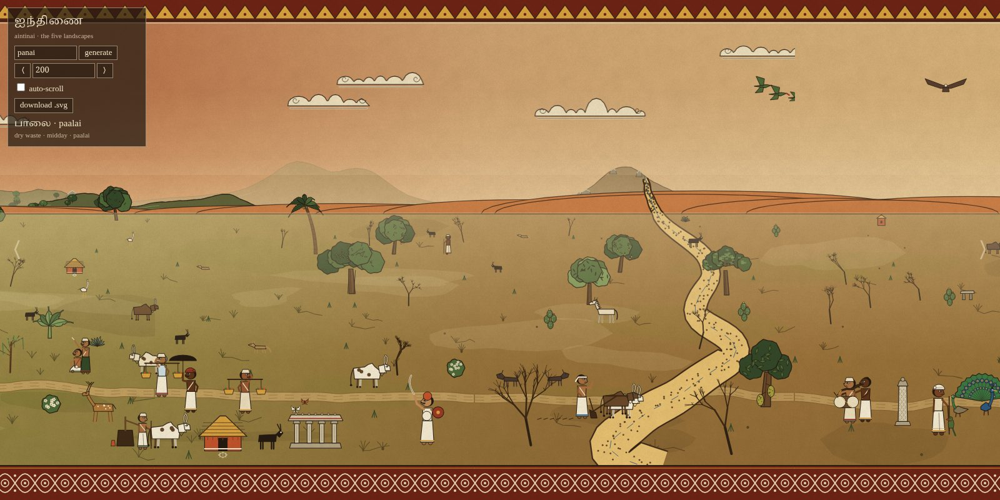
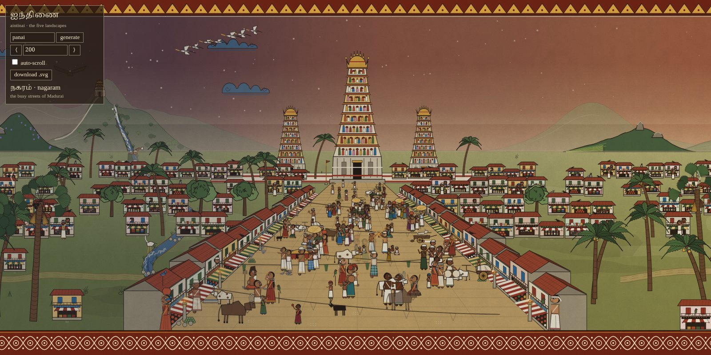
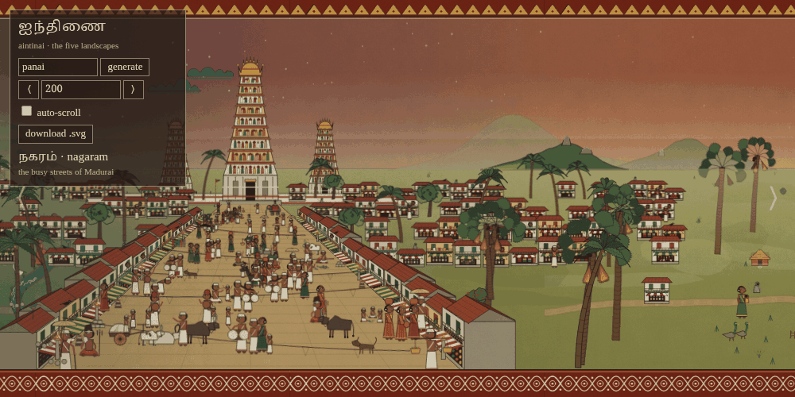
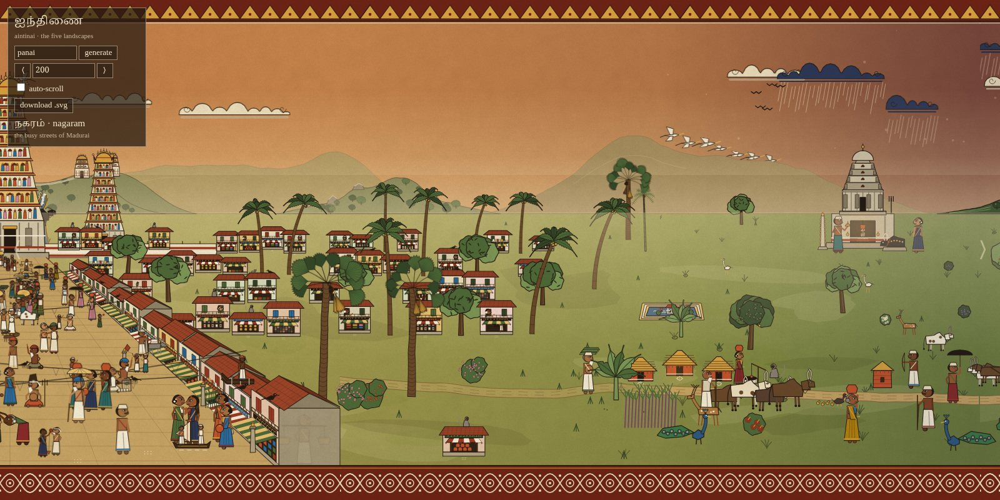
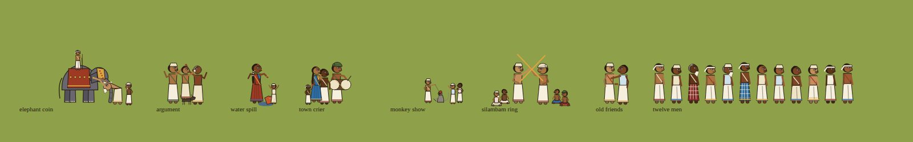

# ஐந்திணை · Aintinai

An infinitely scrolling Tamil landscape, generated in the browser and painted
in the manner of the Nayak temple murals of Thanjavur, Srirangam and
Thiruvarur: flat mineral pigment, black outlines, stacked registers, and a
decorative border. Every scene is a mix of river, hill and land, drawn from
the Sangam landscapes and the temple and Chola heritage of the country. It runs on the chunk engine of
[{Shan, Shui}\*](../index.html) by Lingdong Huang, with the ink-painting
vocabulary replaced.

Open `index.html` in a browser. Query parameters: `?seed=<text>` fixes the
landscape, `&x=<number>` starts the view at that world position. Scroll with
the arrow keys, the edge arrows, or the panel. Point at anything to see its
name in Tamil and English.

## Screenshots

Seed `panai`. The five landscapes:







A river of the marutham country, entering from the hills and leaving at the
bottom border, with coracles, washerwomen, buffalo and herons along it:


Nagaram, the street of Madurai seen down its length: one road from the
foot of the picture to the temple gopuram at its end, shophouses in
perspective down both sides, bunting strung across, the quarter's rooftops
spreading either side, and the road alive at every depth:



The street moves: strollers pass through, groups mill, carts roll, pigeons
scatter (six frames, half a second apart):



Crossing from the countryside into the town and out again:


The Meenakshi temple of Madurai, its four painted gopurams around the
golden vimana, the pillared hall and the lotus tank:



Names on hover, in Tamil and English:


Night in the hills, lamps glowing in the huts and the temple:


A royal procession, the king on his elephant under the parasol with
spearmen, drummers and the tiger banner:


No two people are the same. Each figure draws an identity: one of five
skin tones, an age, hair and headgear, a moustache or beard, a build, and
clothes:



Every generator at a glance (`gallery.html`, about 175 subjects):


A 4800 unit panorama across the farmland:


Another seed, deep in the paalai:


Against the original for the same seed:


## The idea

Sangam poetics divides the world into five landscapes, the aintinai, each
with its own terrain, time of day, season, flora, fauna and people. Low
frequency noise along x gives each landscape a weight at every position, so
the scroll drifts from one to the next and everything blends: sky colour,
ground colour, the sea, and what gets drawn.

| Tinai | Terrain, time | Drawn |
|---|---|---|
| Kurinji | hills, midnight | ranges of rounded hills with waterfalls, hill forts flying the tiger banner and hill temples, mountain streams, kurinji shrubs in violet bloom, wild elephants, deer, goats, hunters with bows, hill shrines, hero stones, moon and stars |
| Mullai | forest and pasture, evening in the rains | mango and banyan groves, flame of the forest, jasmine, cattle herds with cowherds, peacocks, deer, villages with wells, Chola temples, mandapams, rain clouds |
| Marutham | river farmland, dawn | meandering rivers with coracles and washerwomen, paddy plots, the Meenakshi temple of Madurai, Shiva temples with the lingam in the sanctum, painted gopurams and granite Chola vimanas with Nandi and flag posts, temple chariots hauled on ropes, pillared mandapams, Pongal pots boiling over beside sugarcane, banana, coconut, temple tanks with lotus, bullock carts, buffalo, herons, women carrying pots in procession, men carrying banana leaves, temple elephants |
| Neithal | backwaters and palm groves, sunset | wide rivers with kattumarams and fish, palmyra and coconut groves, banana, fishing huts, drying nets, fish and crabs, herons |
| Paalai | dry waste, midday | dunes, dry sandy riverbeds, thorn trees, goats, wayfarers, Ayyanar's terracotta horses, hero stones, blazing sun |

A sixth zone lies over the five: nagaram, the town, driven by its own slow
noise and kept out of the hills and the waste. Each town is drawn as one
scene in one-point perspective, about a screen wide: a single road runs
from the foot of the picture up to the Meenakshi gopuram, which closes it,
with the compound wall and the inner gopurams behind. Shophouses line both
sides, each built in perspective along the road edge as a solid block, with an
end wall and gable, a tiled roof with its ridge and back slope seen from
above, and a plinth, awning, signboard, balcony rail and shutters that all
converge on the temple, with its goods on show below, and clutter and stone lamps at the
feet of the row. Bunting is strung across the street at
several depths. The quarter's rooftops and palms spread either side. The
road is layered far to near: a stream of tiny pilgrims, temple cows and a
temple elephant at the gate; carts, palanquins, horsemen, musicians,
vendors, pigeons and the street's little stories in the middle distance;
large figures in the foreground. People stroll through and fade, groups
mill, carts roll, pigeons rise, everyone shifts on their feet. The fields,
the dirt road and the countryside people stop at the scene's edge.

Anywhere outside the dry waste a royal procession may pass: the king on a
caparisoned elephant beneath a parasol, with a flag bearer, spearmen with
shields and drummers.

Every person in the scroll is drawn from an identity picked when they are
placed. Skin comes in five tones. Men are young, middle-aged or old, with
a white cap, a coloured turban, bare hair with a kudumi tuft, a thundu
cloth, or a bald head with a fringe; most have a moustache, some old men a
white beard, some are stout; they wear a white or cream veshti or a
checked lungi with a coloured border, and either a bare chest with an
angavastram or a shirt. Women wear a bun with jasmine, a long plait with
flowers, or loose hair, grey when old, with earrings, a nose stud, a
necklace, a red or black pottu, and a sari and blouse from a wider
palette with a chosen border. Heights vary a little too.

Beyond the table above, the landscapes are populated from a catalogue of
about 175 subjects. Peacocks display their trains in the hills and the
groves, with peahens beside them. People at work and at play: silambam
sparring, kolattam and karagattam dancers, jallikattu with the bull let
loose, oil presses, threshing floors, the village school under a tree,
fishermen and punters, washermen at the river, swimmers, mahouts bathing
their elephants, sadhus, women with lamps at dusk, walkers under umbrellas
in the rains, pallanguzhi players, snake charmers, barbers, cockfights,
weddings under a pandal, coconut climbers; ploughmen with their bullocks, women
transplanting paddy, winnowing, pounding rice, grinding, drawing kolams,
carrying firewood or children, potters at the wheel, weavers at the pit
loom, toddy tappers up the palms, net casters, pole carriers, hay carriers,
vendors, garland sellers, fortune tellers with their parrots, elders under
palm-leaf umbrellas, children with tops and kites, nadaswaram and thavil
players, flautists, a Bharatanatyam dancer, priests with lamps, warriors
with sword and shield, horsemen, palanquin bearers. Sacred images: the Chola
bronze Nataraja in its shrine, Pillaiyar under the tree, lingams, Murugan
with the vel, serpent stones. Creatures: hens, roosters and chicks, dogs,
langurs, squirrels, parrots, crows, kingfishers, kites soaring, cobras,
tortoises, frogs, butterflies, sloth bears, tigers, boar, jackals,
crocodiles, elephant calves, horses, washermen's donkeys, bats at dusk,
ducks. Trees and plants: tamarind, neem, jackfruit, peepal, areca, bamboo,
papaya, drumstick, hibiscus, bougainvillea, tulsi in its brick stand,
prickly pear and agave in the waste, reeds and lotus by the water,
sugarcane and millet fields, plantains in fruit, haystacks. Built things:
Chettinad mansions, agraharam rows, inscription pillars, granaries, cattle
sheds, pottery kilns, bullock-drawn well lifts, stone bridges and stepping
stones over the rivers, Chola sailing vessels, lamp towers, dolmens, market
stalls, fences, temple gateways, Pallava rock-cut cave temples and rathas,
huts with pumpkin vines.

## Composition

The page is a mural wall, 800 world units tall:

```
   0 –  34   temple zigzag border (Kanchipuram reku)
  34 – 340   sky: colour by time of day, sun or moon, clouds, birds
 340 – 580   far band: horizon line, hills, paddy, sea, small figures
 580 – 745   near band: large trees, people, animals, buildings
 745 – 800   pulli kolam border
```

Each band is filled per 512 unit chunk. Two population tables in
`js/gen/planner.js` say what each landscape contains and how often; density is
set by a spacing number per landscape and band. Chunks are kept sorted by `y`
so nearer things draw in front.

Night arrives gradually: stars fade in with the kurinji weight, then a blue
tint deepens over the land and lamps glow in hut doorways, lamp towers,
shrines and temples, before the moon appears.

A dirt road winds through the near band along the whole scroll, with
travellers on it: carts, herds, palanquins, horsemen, women with pots,
walkers under umbrellas in the rains. Patches of lighter and darker earth
and the odd pond with lotus and ducks break up the ground.

Things are placed with a footprint check, so a tree no longer grows through
a temple and a woman no longer stands inside a banyan. Much of the near band
is laid out as scene clusters with open ground between them: a hamlet with
its well, hens, dog, haystack and kolam; a temple street with gopuram, tank,
lamp tower, gateway and garland seller; a grove with peacocks and deer; a
pasture; a market; a threshing yard; a weavers' row; a shrine beneath a
banyan.

Depth comes from haze. The far hills are painted mostly in the colour of
the horizon sky with no outline, the middle range half so, and veils of
warm haze lie across the foot of the ranges and over the back of the land.
The ground darkens and warms toward the viewer, and the sky glows above the
horizon.

The page moves gently: clouds drift, rain falls, birds flap and cross the
sky, the water marks on rivers shimmer, flags flutter, kiln smoke rises and
palm crowns sway. It honours the reduced-motion preference.

Hills are world-level features too, decided from the seed for 1000 unit
slots in three layers: a pale distant range, a middle range, and near
hills. Each is a ridge of one to three peaks, steeper in kurinji, and the
nearer ones carry rock outcrops, forested slopes, terraced fields, kurinji
in bloom, hill forts flying the tiger banner, or a summit temple reached by
steps.

Rivers are world-level features. The x axis is divided into 2000 unit slots
and each slot decides from the seed whether it has a river, where it starts,
and how it meanders. A river enters at the horizon (at the shore in neithal),
wanders across both bands, and leaves at the bottom border. Every chunk draws
the part that crosses it, and the planner keeps trees and people off the
water. In paalai the river is a dry sandy bed.

## Layout

```
index.html              page, panel, seed handling, lime plaster overlay
js/engine/prng.js       seedable random (replaces Math.random)       upstream
js/engine/noise.js      Perlin noise                                  upstream
js/engine/polytools.js  polygon helpers                               upstream
js/engine/util.js       mapval, bezier, poly()                        upstream
js/engine/brush.js      stroke, blob, div, texture                    upstream
js/engine/ink.js        INK, line, shape, dot, gradient rects         new
js/engine/chunks.js     MEM, chunk loader and render, view, scroll    rewritten
js/gen/tinai.js         five-landscape noise selector                 new
js/gen/palette.js       mural pigments and per-tinai colour tables    new
js/gen/layers.js        borders, sky, ground, sea, far band           new
js/gen/hills.js         seeded hill ranges with rocks, forest, forts  new
js/gen/river.js         rivers rising on hills, meandering            new
js/gen/road.js          the winding dirt road                         new
js/gen/names.js         Tamil and English names for hover             new
js/gen/palmyra.js       palmyra palm                                  new
js/gen/trees.js         mango, banyan, banana, coconut, thorn, kurinji new
js/gen/figures.js       man (veshti, zari, king, spear, drum, flag,
                        leaves), woman (sari, pots), procession, cow,
                        buffalo, goat, elephant, peacock, deer, heron,
                        fish, crab                                    new
js/gen/arch.js          gopuram, vimana, Chola temple, Nandi, flag
                        post, mandapam, chariot, hero stone, Pongal,
                        hut, kattumaram, horse, shrine, cart, tank,
                        nets, parisal, well, village                  new
gallery.html            every generator drawn once, for checking      new
js/gen/planner.js       population tables and placement              new
```

Engine notes:

- Each chunk is seeded from the page seed plus its x position, so a chunk is
  identical whichever direction you scrolled to reach it.
- A planner returns `{tag, x, y, draw}` entries. Bands use large negative
  or positive `y` to sit at the back or the front.
- The SVG is only rebuilt when the view leaves the rendered range; otherwise
  only the viewBox moves.
- The plaster texture is an HTML overlay multiplied over the SVG, so the
  downloaded SVG is the clean painting.

## Adding a subject

Write a function that returns an SVG string from `(x, y, args)` using
`shape`, `line`, `dot`, `stroke` or `blob` with colours from `Palette`, add a
case to `makeItem` in the planner, and list it in the band tables with a
weight. Use `Tinai.weights(x)` if it should vary with the landscape.
